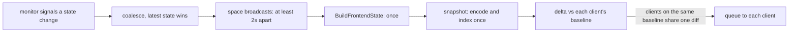

# WebSocket state broadcast

How Pulse keeps open dashboards current, what that costs, and the knobs that
control it. Written while chasing the CPU cost of an open dashboard (#2199): on
a 4 vCPU LXC with about 1,200 resources, a single connected dashboard roughly
doubled Pulse's CPU, and the broadcast worker was about 45% of the process.

## The pipeline



Everything left of the per-client step runs **once per broadcast**, not once per
client. That is why the dominant cost is a fixed price for having at least one
client connected, and why a second tab adds comparatively little.

| Stage | Runs | Notes |
| --- | --- | --- |
| Coalesce and space | per signal | Agent reports signal constantly; the spacing caps broadcasts, not signals. |
| `BuildFrontendState` | per broadcast | Lists and converts every resource, groups top-level systems. |
| Snapshot | per broadcast | One `json.Marshal`, one scan, one retained copy. |
| Delta | per distinct baseline | Clients that received the previous broadcast share one diff and one encoded message. |
| Send | per client | A channel send. |

## Spacing

A broadcast to an audience (all clients, or one tenant) is spaced at least 2s
after the previous one (`defaultStateBroadcastInterval`). That caps a busy
instance at 30 broadcasts a minute per audience however many agent reports
arrive; the latest state always wins, so spacing delays an update but never
drops one. Alerts and other non-state messages are sent immediately and never
go through the spacing.

The interval is a constant. Everything left of the per-client step costs the
same whether one or many clients are connected, so with a dashboard open this
spacing is also the lever on total cost: the work scales with broadcasts per
minute.

## Metrics

Served on the metrics port next to the existing process metrics.

| Metric | Meaning |
| --- | --- |
| `pulse_websocket_state_broadcasts_total` | Broadcasts built and dispatched to at least one client. Rate this for broadcasts per minute. |
| `pulse_websocket_state_broadcast_stage_seconds{stage}` | Histogram: `frontend_state`, `snapshot`, `deltas` per broadcast. |
| `pulse_websocket_state_delta_diffs_total{result}` | `computed` versus `shared`. High `shared` means clients are sharing baselines. |
| `pulse_websocket_state_delta_bytes_total` | Bytes of delta messages queued. |
| `pulse_websocket_state_snapshot_bytes` | Encoded size of the latest snapshot. |

Each series is visible from the first scrape. A quick check on a running instance:

```bash
curl -s http://127.0.0.1:9091/metrics | grep pulse_websocket_
```

## The JSON work, and why the old code is still there

Per broadcast the state is marshalled once and then indexed (fields, and every
resource by id) so per-client deltas can be diffed entry by entry. The original
implementation decoded the encoded state three times and, per client and per
changed entry, decoded both sides into `interface{}` trees to build a merge
patch.

The current code uses a strict single-pass scanner (`json_scan.go`) that
returns sub-slices of one retained buffer and diffs entries as raw bytes. It
validates the complete JSON grammar as it goes and *refuses* anything unusual:
escaped or non-UTF-8 keys, duplicate keys, malformed input. Refused input goes
to the original `encoding/json` implementation, which is kept for exactly that
reason and doubles as the test oracle (`snapshotFromEncodedLegacy`,
`createJSONMergePatchLegacy`). Both are fuzzed against it.

Two behaviours differ from the original on purpose:

- Integers above 2^53 keep their exact digits in a patch. The original
  decoded numbers into `float64` and rounded them.
- Numerically equal but textually different scalars (`0` versus `0E0`) may be
  re-sent in a patch, which is harmless.

## Measuring a change

The benchmarks isolate the once-per-broadcast stages at the scale of the
reported fleet. They are not an installed-fleet CPU benchmark.

```bash
go test ./internal/websocket/ -run xxx -bench 'Broadcast[124]Client' -benchtime=15x
go test ./internal/monitoring/ -run xxx -bench 'BenchmarkBroadcast' -benchtime=10x
```

For the real thing, record whether a dashboard is open (it is the largest
single confound when comparing builds), then sample CPU and the metrics above
over a few minutes with and without one.
